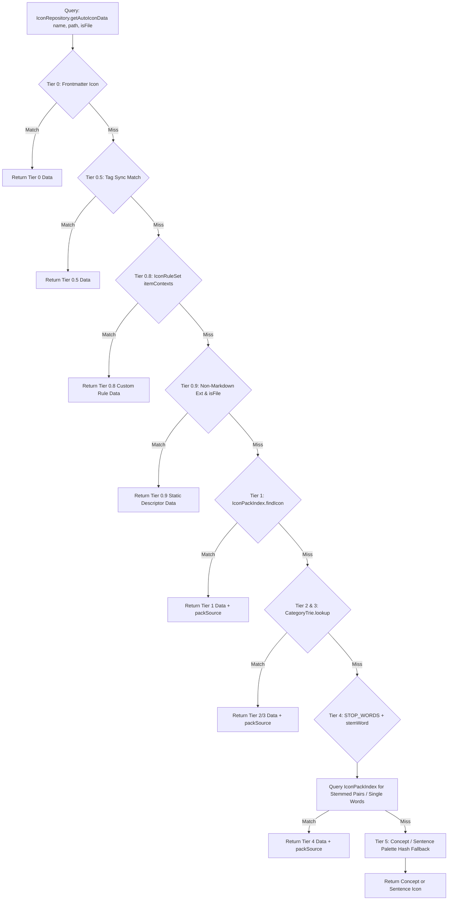

# ⚙️ Engine Internals: Low-Level Logic

> [!NOTE]
> This document details the low-level internals of **Colorful Folders** under the Zero-DOM / `document.adoptedStyleSheets` architecture and the Tiered Icon Selection Engine.

---

## 1. Global Event Lifecycle

Colorful Folders hooks into the Obsidian event bus and DOM observers reactively:

| Event | Handler | Rationale |
| :--- | :--- | :--- |
| `layout-change` | `DOMObserverService` | Re-attaches window document stylesheets to newly rendered explorer containers. |
| `css-change` | `EventTrackerService` | Theme switches (Light/Dark) trigger debounced contrast recalculations. |
| `file-open` | `EventTrackerService` | Updates active folder path markers dynamically (`.is-active-path`). |
| `dragstart` | `EventTrackerService` | Sets `plugin.isDragging = true` and suspends all styling and observer work during drag. |
| `dragend` | `EventTrackerService` | Resets `isDragging` and runs a catch-up render. |
| `create` / `delete` / `modify` | `PluginLifecycleService` | Vault structure changes; invalidates item count, container, and icon caches. File modification events are strictly scoped to plugin files. |
| `scroll` (container) | `DOMObserverService` | Suspends observer calculations during active scroll, queuing a single debounced catch-up sync after scroll stops. |
| `layout-ready` | `PluginLifecycleService` | Triggers startup cache pre-warming via `requestIdleCallback()` for core folder and document icons. |
| `generateStyles` (post-render) | `main.ts / GraphColorSync` | Syncs folder colors to `.obsidian/graph.json` color groups if `graphColorSync` is enabled. |

---

## 2. Low-Level Flat Selector Map

The Zero-DOM engine uses flat attribute selectors to target file explorer items directly via Obsidian's native `data-path` attribute:

### 📂 Folder Elements
- `.nav-folder-title[data-path="..."]`: Target folder title bar.
- `.nav-folder-title[data-path="..."] .nav-folder-title-content::before`: Icon rendered via SVG Data URI mask or Emoji.
- `.nav-folder-title[data-path="..."] ~ .nav-folder-children`: Container tint for nested items.

### 📄 File Elements
- `.nav-file-title[data-path="..."]`: File title bar.
- `.nav-file-title[data-path="..."] .nav-file-title-content::before`: File icon rendered via SVG Data URI mask.

### 📏 Section Dividers
- `.cf-has-divider[data-cf-divider="true"]::before`: Section divider bridge line and pill label.

---

## 3. Tiered Icon Selection Engine Internals

`IconRepository` processes icon resolution across a multi-tier hierarchy using optimized internal data structures:



### 3.1 `IconRuleSet` (`src/core/IconRuleSet.ts`)
- **Single Responsibility Principle (SRP)**: Dedicated, decoupled engine for parsing, compiling, and evaluating user-configured custom icon rules (`settings.customIconRules`).
- **Matching Operator Modes**:
  - `contains`: Substring evaluation via native V8 C++ `String.prototype.includes`.
  - `exact`: Exact equality via native `===` and $O(1)$ exact lookup maps.
  - `starts_with`: Prefix evaluation via native `String.prototype.startsWith`.
  - `ends_with`: Suffix evaluation via native `String.prototype.endsWith`.
  - `regex`: Evaluated via compiled `RegExp` with automatic slash/flags cleanup and ReDoS protections.
- **Dual-Bucket Partitioning & Performance Guards**:
  - Exact match maps (`_folderExact`, `_fileExact`, `_universalExact`): Instant $O(1)$ hash map lookups.
  - Fast-Path Bypass (`_exactRuleCount`): If no exact rules exist, Fast Path A is skipped in $O(1)$ with zero array allocations or lambda closures.
- **Scope Targeting**: Directs rules to `folders`, `files`, or `all` via the `::target` token syntax (`::folders`, `::files`, `::all`).
- **Context Isolation & Leak Prevention (Incident #42)**: Evaluates exclusively against `itemContexts` (`[lName, sanitized, cleanSanitized]`), strictly omitting `parentFolder` so parent folder rules never hijack nested child files.
- **Two-Layer Caching Architecture**:
  - Layer 1: `IconRepository._autoIconResultCache` (4096 entries, keyed by path/name).
  - Layer 2: `IconRuleSet._lookupCache` (2048 entries, keyed by `scope:ctx1\0ctx2\0ctx3` with zero-allocation single-string optimization `scope:ctx`).
- **Robust Regex & Delimiter Parser**:
  - Distinguishes rule assignment delimiters (`' = '`) from regex lookaheads containing `=` (e.g., `(?=project).+ = lucide-folder ::regex`).
  - Automatically strips enclosing `/.../` and unsets global `/g` flags to eliminate stateful `lastIndex` alternation bugs.
- **Shared Static Helpers (DRY)**: Exposes `IconRuleSet.parseRule(line)` and `IconRuleSet.formatRule(pattern, icon, priority, target, mode)` consumed by both runtime compilation and the Settings Rule Builder UI.

### 3.2 `IconPackIndex` (`src/core/IconPackIndex.ts`)
- Maintains `exactMap`, `coreMap`, and `suffixMap` to enable $O(1)$ icon lookups.
- Builds once per session with version-snapshot checking (`_localVersion`, `_customVersion`).
- Resolves suffix collisions at build time using `PACK_PRIORITY` weights:
  `custom` (100) > `lucide` (90) > `tabler` (80) > `simple-icons` (70) > `remix` (60) > `feather` (50) > `font-awesome` (40) > `material` (30).
  - **Structure-Preserving Path Key Normalization**: `normalizePathKey(path)` preserving slashes `/` to eliminate key collision bugs across subfolders.
  - **Memory-Efficient Hierarchy Depth Scanner (`getFastPathSlashes`)**: Zero-allocation $O(\text{len})$ char-code scanner (`charCodeAt(i) === 47`) replacing expensive `path.split('/')` heap allocations during color resolution.
  - **Hierarchy Level Color Mode (`colorMode: "hierarchy"`)**: Directly maps folder color indices to tree depth (`(depth + cycleOffset) % palette.length`) with zero array allocations.
  - **Stemming Engine & Fuzzy Optimizations**: `STOP_WORDS` filtering, `searchFuzzy` length-difference pruning, word-boundary alignment, and single-row Levenshtein memory buffer.

### 3.3 `CategoryTrie` (`src/core/CategoryTrie.ts`)
- Indexes `AUTO_ICON_CATEGORIES` using a true Node-based Prefix Trie (`TrieNode`).
- **Decoupled from Custom Rules**: Built once for built-in categories; custom rules evaluate separately in Tier 0.8 with strict scoping.
- **512-Entry LRU Cache**: Memoizes resolved category candidate arrays for recurring vault terms (`daily`, `notes`, `archive`, `work`) with normalized lowercase keys.
- **Zero-Allocation Parent Resolution**: Extracts parent directory tokens via native `lastIndexOf('/')` and `substring()` without creating intermediate arrays.

### 3.4 Path Key Normalization (`normalizePathKey` / `normalizeIconName`)
- `normalizePathKey(path)` lowercases paths and strips `.md` extensions while preserving `/` path slashes. Prevents key collisions between subfolder files (`"Dev/Notes.md"` $\rightarrow$ `"dev/notes"`) and top-level files (`"DevNotes.md"` $\rightarrow$ `"devnotes"`).
- `normalizeIconName(iconId)` unifies icon key formatting across AI classification, auto-icon matching, and pack index searches.

### 3.5 Stemming & Stop-Word Engine (`STOP_WORDS` / `stemWord`)
- `STOP_WORDS` filters out question words (`how`, `why`, `where`), auxiliary verbs (`is`, `are`, `works`), and structural nouns (`folder`, `file`).
- `stemWord()` strips common English suffixes (`-ing`, `-ed`, `-es`, `-s`) before pack queries.
- Single-word scanning iterates from right to left (last to first) to prioritize primary subject nouns over leading filler words.

### 3.6 $O(1)$ LRU Cache & Targeted Eviction Engine (`src/common/LRUCache.ts`)
- All string, mask Data-URIs, and icon validity lookups are bounded by `LRUCache(2048)` instances (`_normCache`, `_dataUriCache`, `_findPackIconCache`, `_autoIconResultCache`).
- Uses `Map` delete-and-set key reordering for $O(1)$ amortized get/set/eviction operations.
- **$O(1)$ Targeted Auto-Icon Eviction (`invalidateAutoIconCache(path)`)**: Directly deletes `path` and `${fileName}::${path}` from `_autoIconResultCache` in $O(1)$ time (< 0.0001ms), eliminating keystroke main-thread stalls, array allocations, and Smooth Cursor animation lag.
- **Pre-Normalized Mask Data-URI Caching (`getMaskDataUri(iconId, rawSvg)`)**: Caches `-webkit-mask-image: url("data:image/svg+xml,...")` Data-URIs directly in `_dataUriCache`, bypassing `DOMParser` instantiation, regex sanitization loops, and `encodeURIComponent()` overhead during vault CSS traversals.

### 3.7 Visual Styling Decoupling & CSS Compaction (`src/core/StyleGenerator.ts`, `src/core/CssGrouper.ts`)
- **Strict Text/Icon Decoupling (Incident #43)**: Text and Icon color logic evaluate independently. When the user selects `colorText: "none"` or `colorText: "files"`, text is reverted to `var(--text-normal)`, but icons and collapse chevrons (`collapseSels`) remain bound to the resolved icon color (`effFolderIconColor`), retaining assigned palette colors.
- **CSS Custom Property Exposure**: Exposes `--cf-icon-color: ${effFolderIconColor}` on `.nav-folder-title` and `--cf-icon-color: ${effFileIconColor}` on `.nav-file-title` so that DOM-injected icon wrappers (`.cf-icon-wrapper`, `.cf-live-animated-icon`) inherit icon colors cleanly with fallback `var(--cf-icon-color, inherit)`.
- **`CssGrouper` Precision Keys**: Signature keys for batched CSS rules include all differentiating sub-properties (`folderRow_${color.hex}_${effFolderIconColor}_...` and `fileRow_${color.hex}_${effFileIconColor}_...`) to prevent style bleed between items that share the same background tint but have distinct icon colors.

### 3.8 Animated Icon Pre-Registration & Zero-DOM Scroll Pipeline (`src/services/AnimatedIconService.ts` & `src/services/animation/`)
- **Decoupled OOP Domain Architecture**: Monolithic rendering logic is split into 5 single-responsibility domain classes under `src/services/animation/`: `AnimationClassifier` (markup detection & loop caching), `AnimationTemplateFactory` (DOMParser fallback, XSS sanitization, box removal, and LRU template cache), `AnimationViewportManager` (single `IntersectionObserver` off-screen pausing & SMIL syncbase wake), `AnimationPlaybackEngine` (delegated click handling, morph triggers, 300ms throttling), and `AnimationDomMounter` (DRY element injection & row state synchronization).
- **Pre-Registration during CSS Generation**: `StyleGenerator.generateCss()` registers active animated paths into `AnimatedIconService._registeredAnimatedTargets` in $O(1)$ memory during the single traverse pass, eliminating any need to query or parse DOM rows during scroll.
- **Granular Folder State Registration (`RegisteredAnimatedTarget`)**: Supports independent static vs animated icon assignments for closed and open folder actions. Active targets are registered as `closed`, `open`, or `both`.
- **Scoped CSS Pseudo-Element Suppression**: Instead of blanket row suppression, `BaseCssGenerator.ts` generates state-scoped rules hiding the static CSS mask `::before` strictly when that state is animated:
  ```css
  .nav-folder:not(.is-collapsed) > .cf-has-animated-open .nav-folder-title-content::before { display: none !important; }
  .nav-folder.is-collapsed > .cf-has-animated-closed .nav-folder-title-content::before { display: none !important; }
  ```
- **Optical Sizing Alignment**: Standardized sizing to `calc(1.3em * iconScale * wideScale * 1.15)` across `BaseCssGenerator.ts` and `StyleGenerator.ts`, optically balancing embedded SVG viewBox margins with edge-to-edge static CSS masks.
- **Boxless & Frameless Vector Rendering**: All outer bounding boxes, border chrome, and 32x32 hit-target rects (`<rect width="32" height="32" pointer-events="all">`) are permanently purged from JSON icon packs and dynamically stripped by `AnimationTemplateFactory.stripOuterBoxes()`. `<svg>` viewports enforce `overflow: visible` to prevent keyframe clipping.
- **Native Ping-Pong Looping SMIL Chains (Option 1 Batch Transformation)**: Interactive dual-state icons in `icons/generative.json` load natively as continuous ping-pong loops via W3C SMIL syncbases:
  - `Master A`: `id="cf_la_<key>" begin="0s;cf_lb_<key>.end+0.8s"` (starts immediately, loops after B settles).
  - `Master B`: `id="cf_lb_<key>" begin="cf_la_<key>.end+0.8s"` (smooth morph return cycle).
  - Follower animations chain to `cf_la_<key>.begin` and `cf_lb_<key>.begin`.
- **Continuous Loops vs. Play-on-Click Single-Shot Replay**: Distinguishes continuous loops (e.g. `*-loop`, `cf_l[ab]_*`) from single-shot animations (`isLoopingAnimatedIcon`). Single-shot animations replay upon user click or file activation (`replayAnimatedElement`), backed by a 300ms double-click throttle.
- **Instant $O(1)$ Prefix Check**: Pre-checks `line-md-` / `linemd-` prefixes in `isAnimatedIcon()` to bypass raw SVG string reads and regex matches during startup.
- **$O(K)$ Targeted Querying**: `syncAnimatedIcons()` reads directly from `_registeredAnimatedTargets` ($K$, where $K \le 5$), bypassing full-vault sweeps and preserving 60/120 FPS scrolling.
- **Off-Screen SMIL Syncbase Recovery**: Uses `IntersectionObserver` with an offscreen boolean flag (`_cfWasOffscreen`). When stalled elements re-enter the viewport, `AnimationViewportManager.wakeElement()` replaces the stalled `<svg>` with a freshly cloned template `<svg>` node (`el.replaceChild(freshSvg, oldSvg)`), recovering broken Chromium timebases from $t=0$.
- **Complete DOM Teardown**: `clearAllLiveAnimatedIconsFromDom()` detaches all mounted `.cf-live-animated-icon` elements and clears row state classes on plugin unload, restoring Obsidian's DOM to a clean native state.

### 3.9 Canvas & Excalidraw First-Class Extension Architecture (`src/core/IconRepository.ts`, `src/core/StyleGenerator.ts`)
- **First-Class Extension Mapping**: `.canvas` and `.excalidraw` (including `.excalidraw.md`) are integrated directly into Tier 0.9 (`EXTENSION_AUTO_ICONS` mapping `canvas` to `frame` and `excalidraw` to `pencil-ruler`).
- **Dynamic Native Icon Replacement**: Rather than suppressing pseudo-elements, Colorful Folders targets the native `.tree-item-icon` via `hideNativeTreeIcon_${safePath}` (`display: none !important;`) whenever an icon is resolved, cleanly replacing unstyled native icons with Colorful Folders' theme-colored visual icons across all explorer panes.
- **Universal Compatibility**: Works out of the box in standard Obsidian File Explorer and Notebook Navigator without requiring custom rules or manual icon assignments.

### 3.10 Notebook Navigator Container Slot & Dual-Target Icon Bridge (`src/integrations/NotebookNavigator.ts`)
- **Container Slot Mechanics**: Notebook Navigator conditionally mounts `<div class="nn-file-icon-slot">`. When an item has no third-party icon preset assigned, the slot is rendered empty (with `null` child span).
- **Dual-Target Selector Strategy**: Colorful Folders targets both the container slot and standalone icon spans:
  ```css
  body .notebook-navigator .nn-file[data-path="..."] .nn-file-icon-slot,
  body .notebook-navigator .nn-file[data-path="..."] .nn-file-icon:not(.nn-file-icon-slot *)
  ```
- **Dimension Lock & Child Suppression**:
  - Sets `flex: 0 0 auto !important; flex-shrink: 0 !important;` to lock icon slot dimensions across list and compact modes.
  - Safely suppresses nested elements via `.flatMap()` child selectors (`> svg`, `> span`) without trailing comma syntax anomalies.
- **Decoupled Background & Icon Integration**: Style generation runs whenever `notebookNavigatorSupport` is active. Background coloring is independently gated by `shouldColorNN`, ensuring file icons and typography remain fully active regardless of whether file background blocks are enabled.

### 3.11 Seeded Variety Hashing & Self-Healing Cache Invalidation (`src/core/IconRepository.ts`)
- **Seeded Variety Hashing**: When `autoIconVariety` is enabled, computes `hashString(seed !== 0 ? `${baseStr}#${seed}` : baseStr)` where `baseStr = path || name` and `seed = settings.varietySeed || 0`.
- **Array Rotation**: Rotates `match.emojis` and `match.lucides` arrays (`[selected, ...remaining]`), guaranteeing that the variety selection is preserved across all fallback pack resolvers in `StyleGenerator.ts`.
- **Self-Healing Cache Guards**: Tracks `_lastVarietySeed` and `_lastVarietyEnabled` in `getAutoIconData()`, automatically flushing `_autoIconResultCache` whenever the user modifies the seed or toggles variety.
- **Immediate Re-Roll**: Clicking "Shuffle icons" generates a new random seed (`Math.floor(Math.random() * 1000000) + 1`), flushes auto-icon and animated icon caches, immediately triggers `await generateStyles()`, and displays an Obsidian `Notice`.

### 3.12 Cold Start Optimization & Observer Throttling Pipeline
- **Zero-Cost High-Frequency Event Guards**: Document click listeners in `EventTrackerService.registerClickEventsForDoc()` and `file-open` event handlers are guarded by `if (!hasAnyAnimatedIcons()) return;`. When animated icons are not in use, click handling exits in < 0.0001ms with zero DOM traversal, zero closure allocations, and zero `setTimeout` calls.
- **Deferred Pre-Warming**: Post-startup disk scanning (`loadLocalIcons`, `loadLocalCustomIcons`) and core icon pre-warming are deferred to post-startup idle time (~1-2s delay) via `requestIdleCallback()`.
- **Exhaustive Container Cleanup**: On plugin unload, `DOMObserverService.destroy()` cleans up scroll listeners from all active containers (native file explorer + Notebook Navigator), and `PluginLifecycleService.destroy()` invalidates all LRU caches in `IconRepository` to prevent heap memory retention across reloads.


---

## 4. Performance & Caching Engine

### Debounced & Incremental Architecture

- **`generateStylesDebounced` (100ms)**: Coalesces rapid style updates into a single `generateStyles()` execution.
- **`saveDataDebounced` (1000ms)**: Debounces settings disk writes.
- **Incremental Heatmap Parent Scanner**: `vault.on('modify')` and `vault.on('create')` incrementally update parent folder `mtime` values in $O(\text{depth})$ time (~0.01ms), eliminating 300ms+ full vault rescans during style generation in Heatmap mode.

---

## 5. AdoptedStyleSheet Lifecycle & Mobile Fallback Engine

- Programmatic `CSSStyleSheet` instance owned by `AdoptedStyleSheetService`.
- Attached to `activeDocument.adoptedStyleSheets` and all popout window documents.
- `sheet.replaceSync(cssString)` executes in < 0.1ms without creating HTML `<style>` elements or modifying DOM child nodes.
- **Mobile & Legacy WebKit Fallback**: For older mobile OS versions or webviews that lack `CSSStyleSheet` constructor or `adoptedStyleSheets` support, `AdoptedStyleSheetService` automatically injects and manages a fallback dynamic `<style id="cf-dynamic-styles">` element inside `doc.head`, guaranteeing 100% rendering compatibility across iOS, Android, Linux, and Windows.
